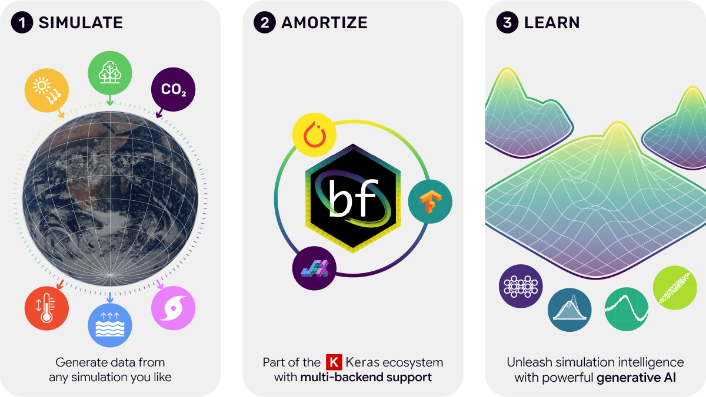

# BayesFlow


[](https://doi.org/10.21105/joss.05702)


BayesFlow is a Python library for simulation-based inference (SBI) with deep learning.
It provides users with:

- A user-friendly API for [amortized Bayesian workflows](https://arxiv.org/abs/2602.07098)
- A rich collection of generative models, [from diffusion to consistency models](https://bayesflow-org.github.io/diffusion-experiments/)
- Multi-backend support via [Keras 3](https://keras.io/keras_3/): You can use [PyTorch](https://github.com/pytorch/pytorch), [TensorFlow](https://github.com/tensorflow/tensorflow), or [JAX](https://github.com/google/jax)

## Conceptual Overview

<div align="center">
<picture>
  <source media="(prefers-color-scheme: dark)" srcset="./img/bf_landing_dark.png">
  <source media="(prefers-color-scheme: light)" srcset="./img/bf_landing_light.png">
  
</picture>
</div>

BayesFlow is a flexible framework for Bayesian inference with deep learning—from idea to results in just a few lines of code. Train neural posterior, likelihood, ratio, or point estimators; ensemble or compose them; tackle filtering, smoothing, or arbitrary hierarchies using modern generative AI. BayesFlow works with both complex simulators and traditional parametric models, with seamless PyMC integration and a rich suite of diagnostics for validating and understanding results.

## Install

We currently support Python 3.12 and 3.13. You can install the latest stable version from PyPI using:

```bash
pip install "bayesflow>=2.0"
```

Or with [uv](https://docs.astral.sh/uv/) (recommended for faster installs):

```bash
uv add bayesflow
```

If you want the latest features, you can install from source:

```bash
pip install git+https://github.com/bayesflow-org/bayesflow.git@dev
```

If you encounter problems or require more control, see the detailed setup instructions in [CONTRIBUTING.md](CONTRIBUTING.md).

### Backend

To use BayesFlow, you will also need to install one of the following machine learning backends.
Note that BayesFlow **will not run** without a backend.

- [Install JAX](https://jax.readthedocs.io/en/latest/installation.html)
- [Install PyTorch](https://pytorch.org/get-started/locally/)
- [Install TensorFlow](https://www.tensorflow.org/install)

If you don't know which backend to use, we recommend JAX as it is currently the fastest backend. The backend is set automatically using a priority order. You can also manually [set the backend environment variable as described by Keras](https://keras.io/getting_started/#configuring-your-backend). For example, inside your Python script write:

```python
import os
os.environ["KERAS_BACKEND"] = "jax"
import bayesflow
```

If you use conda, you can alternatively set this individually for each environment in your terminal. For example:

```bash
conda env config vars set KERAS_BACKEND=jax
```

Or just plainly set the environment variable in your shell:

```bash
export KERAS_BACKEND=jax
```

## Getting Started

Using the high-level interface is easy, as demonstrated by the minimal working example below:

```python
import bayesflow as bf

workflow = bf.BasicWorkflow(
    inference_network=bf.networks.FlowMatching(),
    inference_variables=["parameters"],
    inference_conditions=["observables"],
    simulator=bf.simulators.SIR()
)

history = workflow.fit_online(epochs=20, batch_size=32, num_batches_per_epoch=200)

diagnostics = workflow.plot_default_diagnostics(test_data=300)
```

For an in-depth exposition, check out our expanding list of resources below.

### Books

Many examples from *Bayesian Cognitive Modeling: A Practical Course* by Lee & Wagenmakers (2013) are implemented with BayesFlow in this [online book](https://kucharssim.github.io/bayesflow-cognitive-modeling-book/).

### Videos

Several video tutorials are available as part of the [Learning Bayesian Statistics](https://learnbayesstats.com/) podcast:

1. Marvin Schmitt on [Amortized Bayesian Inference with Neural Networks](https://www.youtube.com/watch?v=_lotzkvy6mY)
2. Jonas Arruda on [Diffusion Models for Simulation-Based Inference](https://www.youtube.com/watch?v=ZlcEkHXgF5k)

### Tutorial notebooks

1. [Diffusion starter](examples/Diffusion_Models.ipynb) - A small tutorial on the power of diffusion models for SBI.
2. [Minimal amortized workflow](examples/SIR_Posterior_Estimation.ipynb) - Build an amortized inference workflow with an SIR simulator.
3. [Time-varying parameters](examples/Bivariate_Smoothing.ipynb) - Estimate latent trajectories with autoregressive estimators.
4. [Image or other spatial data](examples/Spatial_Data_and_Parameters.ipynb) - Learn parameters from or generate image data.
5. [Generalized linear models](examples/Bayesian_GLM.ipynb) - Estimate Bayesian GLMs with multiple predictors, interactions, and varying rows.
6. [Foundation models as backbones](examples/Foundation_Models.ipynb) - Easily turn TabPFN or other foundation models into Bayesian estimators.
7. [Neural likelihood estimation](examples/Likelihood_Estimation.ipynb) - Learn synthetic likelihood functions and plug them into the PyMC ecosystem.
8. [Neural ratio estimation](examples/Ratio_Estimation.ipynb) - Learn neural ratios for downstream MCMC sampling using the classifier trick.
9. [Compositional estimation](examples/Compositional_Diffusion.ipynb) - Estimate hierarchical Bayesian models via composition.
10. [Deep Ensembles](examples/Ensembles.ipynb) - Train different networks at the same time and combine their inferences.
11. [Self-consistency](examples/Self_Consistency.ipynb) - Refine posterior estimates using unlabeled observations.
12. [Model comparisons](examples/One_Sample_TTest.ipynb) - Learn the basic workflow of Bayesian model comparison.
13. [Model comparison deep dive](examples/Model_Comparison_Deep_Dive.ipynb) - Explore different approaches and scoring rules in the Bayesian model comparison workflow.
14. [Multimodal data](examples/Multimodal_Data.ipynb) - Fuse different data types for more informative inference.
15. [Bayes estimators](examples/Lotka_Volterra_Point_Estimation.ipynb) - From simple point estimates to fully Bayesian inference.
16. [From ABC to BayesFlow](examples/From_ABC_to_BayesFlow.ipynb) - Upgrade from sequential to amortized inference.
17. [Bayesian experimental design](examples/Bayesian_Experimental_Design.ipynb) - Perform adaptive sequential experiments.

### Tutorial papers

1. Arruda, J., Bracher, N., Köthe, U., Hasenauer, J., & Radev, S. T. (2025). Diffusion Models in Simulation-Based Inference: A Tutorial Review. *arXiv preprint arXiv:2512.20685; accepted in Transactions on Machine Learning Research (TMLR) with Survey Certification*. [Project page](https://bayesflow-org.github.io/diffusion-experiments/). [Paper](https://arxiv.org/abs/2512.20685)

More tutorials are always welcome! Please consider submitting a pull request if you have a cool application that you want to contribute.

### Agentic AI Workflows

Turn your AI agent into an amortized Bayesian expert using [Baygent Skills](https://github.com/Learning-Bayesian-Statistics/baygent-skills).

## Contributing

If you want to contribute to BayesFlow, we recommend installing it from source. See [CONTRIBUTING.md](CONTRIBUTING.md) for more details.

## Reporting Issues

If you encounter any issues, please don't hesitate to open an issue on [GitHub](https://github.com/bayesflow-org/bayesflow/issues) or ask questions on our [Discourse Forums](https://discuss.bayesflow.org/).

## Documentation & Help

Documentation is available at https://bayesflow.org. Please use the [BayesFlow Forums](https://discuss.bayesflow.org/) for any BayesFlow-related questions and discussions, and [GitHub Issues](https://github.com/bayesflow-org/bayesflow/issues) for bug reports and feature requests.

## Citing BayesFlow

If you are using the new multi-backend version of BayesFlow, we recommend citing our new [software paper](https://arxiv.org/abs/2602.07098) (Kühmichel et al., 2026). If you use the [legacy version](https://joss.theoj.org/papers/10.21105/joss.05702), you can still reference Radev et al. (2023).

**BibTeX:**

```
@article{kuhmichel2026bayesflow,
  title={{BayesFlow} 2: Multi-backend amortized {B}ayesian inference in Python},
  author={Kühmichel, Lars and Huang, Jerry M and Pratz, Valentin and Arruda, Jonas and Olischläger, Hans and Habermann, Daniel and Kucharsky, Simon and Elsemüller, Lasse and Mishra, Aayush and Bracher, Niels and Jedhoff, Svenja and Schmitt, Marvin and Bürkner, Paul-Christian and Radev, Stefan T},
  journal={arXiv preprint arXiv:2602.07098},
  year={2026}
}

@article{bayesflow_2023_software,
  title = {{BayesFlow}: Amortized {B}ayesian workflows with neural networks},
  author = {Radev, Stefan T and Schmitt, Marvin and Schumacher, Lukas and Elsemüller, Lasse and Pratz, Valentin and Schälte, Yannik and Köthe, Ullrich and Bürkner, Paul-Christian},
  journal = {Journal of Open Source Software},
  volume = {8},
  number = {89},
  pages = {5702},
  year = {2023}
}
```

## FAQ

-------------

**Question:**
I am starting with BayesFlow. Which backend should I use?

**Answer:**
We recommend JAX as it is currently the fastest backend.

-------------

**Question:**
I am getting `ModuleNotFoundError: No module named 'tensorflow'` when I try to import BayesFlow.

**Answer:**
One of these applies:

- You want to use TensorFlow as your backend, but you have not installed it. See the [TensorFlow installation guide](https://www.tensorflow.org/install).

- You want to use a backend other than TensorFlow, but have not set the environment variable correctly. See the [Keras backend configuration guide](https://keras.io/getting_started/#configuring-your-backend).

- You have set the environment variable, but it is not being picked up by Python.
This can happen silently in some development environments (e.g., VSCode or PyCharm).
Try setting the backend as shown [here](https://keras.io/getting_started/#configuring-your-backend)
in your Python script via `os.environ`.

-------------

**Question:**
What is the difference between BayesFlow 2 and previous versions?

**Answer:**
BayesFlow 2.0+ is a complete rewrite of the library. It shares the same overall goals as previous versions but offers much better modularity and extensibility. Additionally, BayesFlow 2 supports multiple backends through Keras 3, whereas the previous version was based on TensorFlow.

-------------

## Awesome Amortized Inference

If you are interested in reviews, software, papers, and other resources related to amortized inference, feel free to explore our [community-driven list](https://github.com/bayesflow-org/awesome-amortized-inference). If you'd like a paper (by yourself or someone else) featured, please add it to the list with a pull request, an issue, or a message to the maintainers.

## Acknowledgments

This project is currently managed by researchers from Rensselaer Polytechnic Institute, TU Dortmund University, and Heidelberg University. It is partially funded by the National Science Foundation (NSF) Award Number 2448380 and the Deutsche Forschungsgemeinschaft (DFG, German Research Foundation) Projects 528702768 and 508399956 as well as DFG Collaborative Research Center 391.

BayesFlow is a [NumFOCUS Affiliated Project](https://numfocus.org/sponsored-projects/affiliated-projects).
